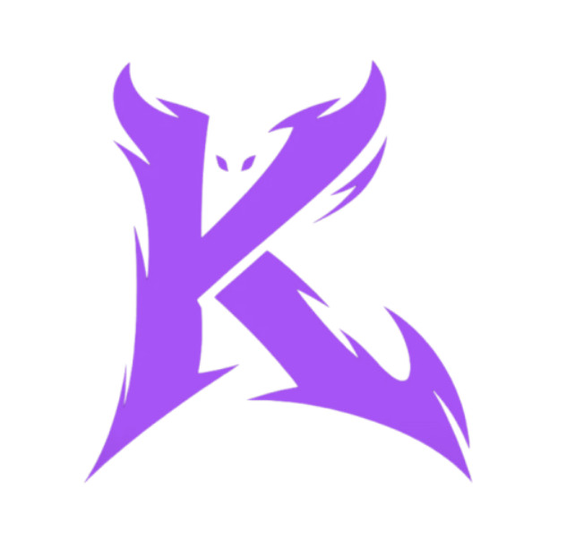

<div align="center">



# Krypt Editor

**A free, open-source video editor for your desktop.**

Cut, trim, compose, caption and export on a real multi-track timeline, with on-device AI for auto edits, captions, reframing and voice-over. Or have the whole video made for you: from a script, from a website, from a recording of an app, or by your own AI agent. No account, no watermark, no cloud.

[](https://github.com/kryptccgit/KryEditor/actions/workflows/release.yml)
&nbsp;[](LICENSE)
&nbsp;[](#download)
&nbsp;[](#download)
&nbsp;[](#download)
&nbsp;[](#download)
&nbsp;[](#download)

<a href="../../releases/latest"></a>
&nbsp;<a href="https://discord.gg/muzFKR657F"></a>
&nbsp;<a href="https://krypt.cc/tools"></a>

</div>

---

Krypt Editor is a no-bloat, CapCut-style editor that runs entirely on your machine. Layer video, audio, titles and shapes on a multi-track timeline, grade with LUTs and GPU effects, and animate anything with keyframes. On-device AI cuts the dead air out of a talking video, lets you edit by deleting words from the transcript, captions it word by word, reframes it to vertical and replaces a voice with a natural-sounding one. It also makes whole videos: a narrated explainer from a script, a product demo from a screen recording, a trailer for your app, a quiz, a comic story. And you can hand the whole editor to Claude, Cursor, Codex or any MCP client and edit by asking. Free, no ads, no telemetry. Built on [OpenCut](https://github.com/OpenCut-app/OpenCut) (MIT).

## What it does

### Edit

- **Multi-track timeline** — video, audio and overlay tracks with mute / solo / lock / hide; trim, split, ripple delete, close gaps, snapping, marquee select, filmstrip thumbnails and waveforms.
- **Compositing** — real layering with per-clip opacity, 16 blend modes, feathered shape masks, transform handles, crop, rotation, rounded corners, shadow, and **3D tilt** (lean a clip back or sideways in space, like an app window shown at an angle).
- **Canvas** — sized from your first clip, or 16:9 / 9:16 / 1:1 / 4:5 presets, over a solid, gradient or blurred-clip background.
- **Effects** — color adjust, `.cube` 3D LUTs graded on the GPU, look filters, real-time glitch / VHS / chromatic aberration / CRT / film grain / pixelate, chroma key and on-device AI background removal.
- **Text & titles** — fonts, outline, glow, background boxes, in/out animations including typewriter and word by word, emoji stickers, vector shapes and freehand drawing.
- **Transitions** — crossfade, dip, flash, slide, push, wipe, zoom, spin, whip pan and blur: drop one on a seam, with a matching audio crossfade.
- **Animations** — every clip can animate in and out (fade, slide, pop, bounce, stomp, fly in…) and carry a whole-clip motion (slow zoom, pan, pulse, float, shake), identical in preview and export.
- **Keyframes** — animate transform, tilt, crop, opacity, volume, speed and overlay position with easing; they survive splits and trims.
- **Speed curves** — Montage, Hero, Bullet and Jump cut presets or your own ramps, pitch-preserved in preview and export, plus freeze frame and reverse.
- **Sound on its own track** — a video's sound is its own linked clip, so you can mix, mute, denoise or replace it. **Sync by sound** lines up a better microphone recording, or a second camera, to within a frame.
- **Audio** — keyframable volume, fades, on-device noise reduction, one-click **Enhance voice** with EQ, compressor and a level meter, **auto duck** for music under a voice, and loudness-normalized exports at −14 / −16 / −23 LUFS.
- **Any footage** — ProRes, DNxHD, 10-bit camera files, AVI, MTS, MXF and more are converted to a working copy on import when [FFmpeg](https://ffmpeg.org) is installed. 4K gets a small preview copy so it scrubs smoothly; exports always read the original.
- **Frame-accurate preview** — paused, you see the exact frame under the playhead. **J / K / L** shuttle at up to 8x.
- **Export** — MP4 (H.264, or HEVC / AV1 where your computer can encode them), WebM (VP9/Opus), or sound only as M4A or WAV, up to 4K, hardware-encoded when your GPU supports it and streamed to disk. An untouched recording at its own size is copied losslessly in seconds.
- **Projects** — `.krypt` files with crash-safe saves, autosave with backups, recents and starter templates.

### On-device AI

- **Auto edit** — finds the pauses and cuts them in one undo step across every track, with presets for talking head, voice-over, podcast and gameplay. **Speech (AI)** mode listens with Whisper so game audio and music don't count as talking, and can also drop filler words, cut retakes and caption in the same pass.
- **Edit by transcript** — see what was said beside the video; select words and press Delete to cut them from every track.
- **Auto reframe** — turn landscape into 9:16, 1:1 or 4:5 in one go, with an on-device face detector keeping the speaker in shot.
- **Auto-captions** — on-device Whisper with word-level timing, karaoke highlighting, full styling and SRT/VTT import/export. **Fast** or **Accurate** models, on the GPU when there is one.
- **Text to speech** — 28 natural English voices (Kokoro, the voice engine from Krypt Studio). Type a line and it lands on the timeline. Spanish, French, German, Portuguese and Korean voices are included too, but those five are licensed for **non-commercial use only** (CC BY-NC 4.0): keep them out of videos you earn money from. The app says so when you pick one.
- **Re-voice** — replace a clip's speech with one of those voices at the same timing, fixing or rewriting any line first.
- **Pictures from words** — make a picture from a description, with a model on your own graphics card (free, nothing leaves the computer) or a picture service with your own key (OpenAI, Google Gemini, xAI). The key is stored encrypted and a daily limit stops a mistake from running up a bill.

### Make a whole video

- **Make a video with AI** — one button in the top bar offers four ways to have a video made for you: from a script, from a website, from an app on your screen, or by your AI agent.
- **Longform** — a whole narrated video from a script, in sixteen formats: Explainer, Documentary, Video essay, Top list, Tutorial, Lecture, Product walkthrough, Comparison, News recap, Data story, Timeline, Podcast (two voices), Commentary, Comic story, Software trailer and Quiz. The narration is spoken on your computer, captions follow the voice word by word, key points land as they are said, and every section is a chapter. The result is ordinary clips on the timeline, so you can change anything afterwards.
- **Drawn visual styles** — no pictures of your own? Pick a style and they are drawn for you: stick figures (Stickman, Whiteboard, Chalkboard, Blueprint, Night sketch) or a 3D character (3D render, 3D cartoon, Retro 3D) that acts out every sentence with its mouth moving to the voice. Drawn on your computer, with no image generator and no account.
- **Video of an app** — a guide, a product demo or a trailer of any software, from one recording of it. Click through what you want to show; the recording is cut into steps where you clicked. Name the steps and pick what to make.
- **Software trailer** — a launch video cut to a beat: opening lines that come up word by word over your app at an angle, the name on a hit, then each feature's window tilting in and moving in on the part that matters, and an end card with where to get it. With no song of your own it writes the music for that video.
- **Quiz** — reads each question out, counts down with a ticking clock, then lights the right answer with a chime.
- **Comic story** — every sentence becomes one drawn panel, cut in on the words. A panel that stays up is animated instead of frozen.
- **From a recording** — give an agent a podcast episode, a talk or a voice memo and it becomes a video in its own voice, with captions, chapters and pictures.
- **Lectures** — drop a PDF and every slide becomes a picture; a connected agent lines each one up with the moment you talk about it. Key points build as you say them, and chapters copy straight into a video description.
- **Find pictures** — search Wikimedia Commons or Openverse for photos that are free to use, also in videos you earn from. Each is saved with its credit, and the credits can be copied for the description.
- **Thumbnail** — a few big words over a drawing, a frame of the video or a picture, saved at 1280×720. Three takes to choose between.
- **Take after a channel** — point it at a YouTube channel you like and it reads the public feed: how it titles its videos, how often it uploads, which uploads beat its usual views, and the colours its thumbnails lean on. Nothing of the channel is downloaded or reused.

### Record

- **Record** — a screen or a single window, a camera and a microphone, straight onto the timeline in sync. Written to disk second by second, so a crash an hour in loses nothing.
- **Product demo** — a screen recording that looks directed: it sits in a window frame on a backdrop, zooms in on each thing you click, and every click gets a highlight and a sound. The zooms are ordinary keyframes you can edit.
- **Film a web page** — footage of a website without recording your screen. Give an address and the steps (`click Pricing`, `type hello into Search`); Krypt Editor opens the page in a hidden, signed-out window of its own and films only that page.

### AI agents (MCP)

- **Connect in one click** — Claude Code, Claude Desktop, Codex, Cursor, VS Code, Windsurf, Gemini CLI or any other MCP client, then edit by asking: *"cut the pauses"*, *"make it vertical and add a title"*, *"make a ten-minute documentary from this script"*, *"make a trailer from the recording I just made"*. 63 tools reach the whole editor, each change is one undo step, and it all stays local.
- **Edit styles and notes** — pick a style (Viral short, Cinematic, Clean tutorial, Lecture, Gaming hype…) and every agent edits to it. Notes are standing instructions every agent reads. Point an agent at a **reference video** and it measures the pace and the look and saves them as a style of your own.
- **Gaming montage** — ask an agent for one: it finds the highlights in your clips and the beats in your song, then lands every moment on a beat with a speed ramp.
- **Before / after** — ask for a wipe, slider, split or cut reveal of what an edit or a look did.
- **Drawn by your agent** — a connected agent can draw the pictures itself, as vector panels that are sharp at any size and move slightly when they stay on screen.
- **Agents can record an app** — an agent can record one window of another app, and on Windows click in it. You are asked every time in a prompt the agent cannot answer, and it stops the moment you move the mouse.
### Also in the app

- **Guides** — a page of one-minute videos, made in Krypt Editor, that each show one thing. They ship with the app and play offline.
- **Upload through Krypt Marketo** — when [Krypt Marketo](https://krypt.cc/tools) is installed, a button hands the exported video over with its title, description and chapters. Nothing is public until you press Save.

## Local and private

- **No account, no watermark, no telemetry** — nothing about you or your projects is sent anywhere unless you ask for it.
- **Editing works offline.** Optional features download a model the first time you use them, then cache it: auto-captions (Whisper: about 300 MB, or 1–1.6 GB for Accurate), text to speech (Kokoro: about 340 MB; MMS-TTS for other languages), AI background removal and auto reframe (MediaPipe), and pictures from words (841 MB or 1.8 GB, only when you press Download).
- **A few features use the internet because that is what they do:** Find pictures sends your search words to Wikimedia Commons or Openverse, Take after a channel reads a YouTube feed, Film a web page opens the address you give it, and a picture service with your own key receives the description you typed.
- **AI agents connect over a local pipe** with a per-user token, and there's an off switch and an activity log for everything they do.

## Download

<a href="../../releases/latest"></a>

Grab the latest **`Krypt Editor-Setup-x.y.z-x64.exe`** (or `-arm64.exe`) from the [**Releases**](../../releases) page and run it (Windows 10/11). Releases also carry an **unsigned macOS build for Apple Silicon** (dmg and zip) and a **Linux x64 AppImage** (and tar.gz), which get less testing than the Windows one.

> Builds aren't code-signed yet, so the first launch may show a SmartScreen prompt — click **More info → Run anyway**. The full source is right here if you'd rather build it yourself.

Optional: install [FFmpeg](https://ffmpeg.org) (`winget install ffmpeg`, `brew install ffmpeg`, or your distribution's package) and Krypt Editor uses it to open footage it can't decode by itself. It is not shipped with the app.

### Opening it on macOS

The mac build is not notarized (Apple charges $99/yr for the certificate that would make this unnecessary), so the first launch needs one manual approval:

1. Open the `.dmg` and drag **Krypt Editor** to Applications.
2. Launch it once. macOS refuses — pick **Done**.
3. **System Settings → Privacy & Security**, scroll to Security: *"Krypt Editor was blocked"* → **Open Anyway**, then confirm.

### Running it on Linux

Download the `.AppImage`, make it executable (`chmod +x`) and run it, or unpack the `.tar.gz`.

## Build from source

```bash
git clone https://github.com/kryptccgit/KryEditor.git
cd KryEditor
npm install
npm run dev        # Vite + Electron with HMR
npm run typecheck  # tsc for renderer + main
npm test           # pure-logic unit tests
npm run dist       # build the installer for your OS into /release
```

Requires [Node.js](https://nodejs.org) 20+. Built with Electron, React, TypeScript, Vite, Tailwind and Zustand. Every push to `main` builds the Windows, macOS and Linux installers and attaches them to a GitHub Release. How the editor is put together is written up in [src/editor/README.md](src/editor/README.md).

## Links

- **Website** — [krypt.cc/tools/editor](https://krypt.cc/tools/editor) · more free tools at [krypt.cc/tools](https://krypt.cc/tools)
- **Support and community** — [Discord](https://discord.gg/muzFKR657F)
- **Credits** — bundled libraries and AI models are listed in [THIRD-PARTY-NOTICES.md](THIRD-PARTY-NOTICES.md)

## License

Released under the [MIT License](LICENSE) — free to use, fork and share. Please don't rebrand and resell it. Based on [OpenCut](https://github.com/OpenCut-app/OpenCut) (MIT). Provided **as-is, with no warranty**.

<div align="center"><sub>Built by the Krypt team · <a href="https://krypt.cc/tools/editor">krypt.cc/tools/editor</a></sub></div>
